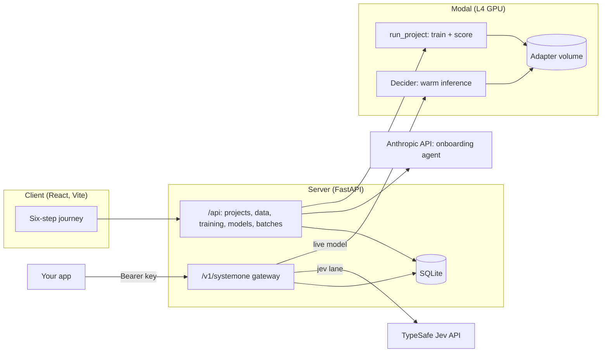

# system1

**Your team's own decision model, trained on your decisions, behind the API you already use.**

system1 turns a decision a team makes again and again into its own small, fine-tuned decision model ("sys1"). That might be which queue a ticket goes to, whether a refund is approved, which rep gets a lead, or whether an expense passes policy. The model is trained on the team's own examples and served behind the same endpoint as Jev, TypeSafe's general decision model, so switching is a one-line change of base URL.

By Thomas Michalski and Nicholas Stranges. The product thinking is in [docs/product-brief.md](docs/product-brief.md).

## Test it
Upload a small data subset from /examples/finance_complaints_small.csv to the frontend. Derived from BANKING77.

## The problem

General decision models are good at everyone's decisions and so-so at any one team's. Jev cannot be fine-tuned on customer data, so a team can only shape it through the question, the instructions and the bucket descriptions it sends. That leaves three gaps:

- **Accuracy on their own buckets.** The fine distinctions that matter to one team, like two refund reasons that look alike, are where a general model guesses.
- **Many options.** Jev's prompt budget is shared across options, and accuracy drops as the list grows. Real decisions often have dozens of buckets.
- **Honest confidence.** An over-confident "how sure" cannot safely decide which answers a person should check.

Fine-tuning fixes this, but it needs labelled data, ML engineers and GPUs, which most teams don't have. system1 packages all three.

**Who it's for:** any team with a repeated decision it wants a model to make, whether that's routing, approvals, triage, classification or policy checks. They get a model that knows their buckets (including the ones that look alike), a "how sure" signal to send sure answers straight through and unsure ones to a person, and an endpoint their existing Jev integration can call without code changes.

## What it does

A team goes from "we decide these by hand" to a working endpoint in six steps, with an onboarding agent (Claude) at each one. Once a model is live, Use and Improve feed each other.

| Step | What happens |
| --- | --- |
| **Define** | Name the decision and its buckets, with an onboarding agent (Claude) that drafts them from your examples or documents. |
| **Data** | Upload past decisions (CSV, Excel, JSON) or generate practice examples. A data health panel shows which buckets need more. The test split is frozen the first time you train. |
| **Review** | Check the examples the model is least sure about. |
| **Train** | Fine-tune a LoRA on Modal and get a report card: your model, Jev and untrained Laya on the same test examples, with confidence intervals, a verdict, speed, a learning curve, where your model beats Jev by bucket and what it mixes up. |
| **Use** | Try it side by side with Jev, create an API key and call `POST /v1/systemone`. Every trained model is kept; an admin picks which one is live. |
| **Improve** | Check a batch of new messages, correct the unsure answers, retrain, and compare the new version with the live one on the same test set. It is recommended only if it scores higher, and goes live only when an admin clicks "Make live". |

## How it works



- **Training** (`pipeline.py`, `train.py`): Unsloth's `FastDecisionModel` attaches a rank-64 LoRA to Laya, trains on the train split, fits a temperature on the calibration split, then scores the new model and untrained Laya on the frozen test split. Each run's adapter is saved to a Modal volume.
- **Serving**: the `Decider` class loads Laya plus a project's live adapter once, keeps recent ones warm, and scales to zero when idle. The gateway sends `model: "sys1"` to the project's live model, `model: "jev-1.13.0"` to Jev, and `model: "auto"` to sys1 when it is sure and to Jev when it isn't (the handoff is flagged for review).
- **Model**: Laya is a ModernBERT-large backbone with a decision head (Apache 2.0). One forward pass per decision, no text generation.
- **Contracts with fakes**: decision providers, trainers, the LLM and the example generator are interfaces with fake implementations, so the whole app runs and tests without a GPU or API keys.

## Run it locally

You need [uv](https://docs.astral.sh/uv/), [bun](https://bun.sh/), a [Modal](https://modal.com/) account, a [Clerk](https://clerk.com/) app, a TypeSafe API key for Jev and an Anthropic API key.

```bash
make env            # creates .env from .env.example; fill in the keys
make install        # Python deps for the training and eval scripts
make modal-setup    # authenticate the Modal CLI
cd app/server && uv sync && cd ../client && bun install && cd ../..
make modal-deploy   # deploy training and inference to Modal
make dev            # server on :8000, client on :5173
```

Open <http://localhost:5173> and sign in.

| Setting (`.env`) | Purpose |
| --- | --- |
| `TYPESAFE_API_KEY`, `JEV_MODEL` | Jev, pinned to a versioned id (`jev-1.13.0`) for anything reported |
| `ANTHROPIC_API_KEY` | The onboarding agent and example generation |
| `CLERK_PUBLISHABLE_KEY`, `CLERK_SECRET_KEY` | Sign-in and organizations |
| `TRAINER=modal` | Train on Modal (`preview` plays a simulated run, for working on the UI) |
| `SYS1_PROVIDER=modal` | Answer sys1 calls with each project's live model on Modal |

To try the Improve step with real data, upload [data/banking/banking_upload.csv](data/banking/banking_upload.csv) in the Data step, train, then check [data/banking/batch_check_10.csv](data/banking/batch_check_10.csv) in Improve. Six of its ten messages sit between intents BANKING77 is known to confuse.

### Calling the endpoint

```bash
curl -s localhost:8000/v1/systemone \
  -H "Authorization: Bearer s1_YOUR_PROJECT_KEY" \
  -H "Content-Type: application/json" \
  -d '{"model": "sys1", "state": "I still have not received my new card"}'
```

The first call after the model has been idle for 10 minutes takes about a minute while Modal loads it.

## The benchmark

The benchmark scripts at the repo root compare four rows on the same frozen test split: Jev with only the label list, Jev with the written policy, untrained Laya and sys1.

```bash
make eval-jev       # Jev on the hosted API (add LIMIT=50 for a smoke test)
make train          # train the LoRA on Modal, download to ./lora
make eval-laya      # untrained Laya on Modal
make eval-lora      # the trained LoRA on Modal
```

`DATA=` picks the dataset (BANKING77 by default, built by `data/banking/to_decision_parquet.py` with the official test half as the frozen test split). Results land in `results/`. Calibration is computed from `probabilities`, never from `confidence`, because Jev and Laya define confidence differently.

## Repo layout

| Path | What's there |
| --- | --- |
| `app/server/` | FastAPI server (`uv`, `ruff`, `pytest`) |
| `app/client/` | React client (`bun`, Vite, Tailwind, Prettier) |
| `pipeline.py` | Modal entry points the server calls: training and the `Decider` |
| `train.py`, `eval_*.py` | Training and benchmark scripts |
| `data/` | BANKING77 preparation, the support-ticket policy and generators |
| `docs/` | Product brief, specs, plans and API reference notes |
| `tests/` | Tests for the data pipeline and policy |

## Checks

```bash
make test     # data pipeline tests and server tests
make verify   # lint, typecheck, all tests and the client build
make docs     # regenerate the OpenAPI schema and client types after an API change
```

## Trust and data

- **Never trained on Jev.** Jev's answers are never used as training labels or to choose what gets labelled, as TypeSafe's customer agreement (section 2.3b) requires. Confirmed Jev answers are flagged as not trainable when they are written.
- **A test set that never moves.** Test examples are frozen at the first training and never trained on, calibrated on or used to tune prompts. Every comparison is on the same test examples.
- **Jev is pinned.** Jev is pinned to a versioned model id, and its saved answers are reused only for the exact question it was asked.
- **Your organization only.** Clerk organizations scope every project, model, decision and batch; API keys are hashed at rest and tied to one project. Changing the live model or creating keys is limited to admins.
- **People stay in the loop.** Unsure answers go to a person, and a retrained model never replaces the live one without an admin's click.
- **No real customer data in the repo.** BANKING77 is a public dataset (CC BY 4.0, from PolyAI); the support-ticket data is synthetic.

## Roadmap

- **Next:** a learning curve showing how many examples per bucket a team needs.
- **V2:** Era by Eon, to test the onboarding agent.
- **V3:** SurrealDB agent memory, so the agent remembers a team's decisions across sessions.
- **Later:** a Claude connector and MCP server, so teams can build and call their models from Claude.

## Prior work, templates and AI tools

- **Prior work:** Modal and Unsloth training experiments on the public `LocalLLaMA/typed-decisions` dataset, made before this project started.
- **Templates and libraries:** UI components follow [shadcn/ui](https://ui.shadcn.com/). Example generation can use NVIDIA NeMo Data Designer. Models: [Laya](https://huggingface.co/convaiinnovations/laya) (Apache 2.0), trained with [Unsloth](https://unsloth.ai/).
- **AI tools:** Claude Code (Anthropic) was used throughout for planning, code, tests and documentation. Claude also powers the in-app onboarding agent.
